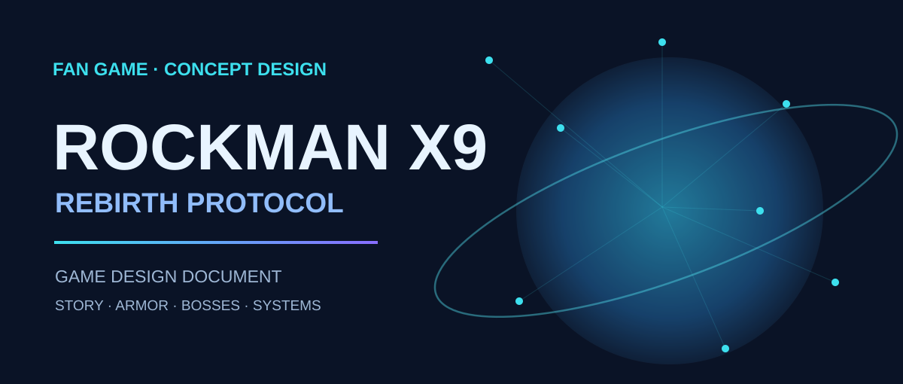
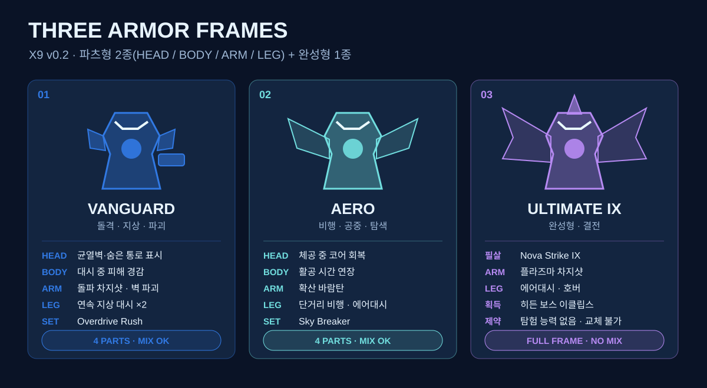
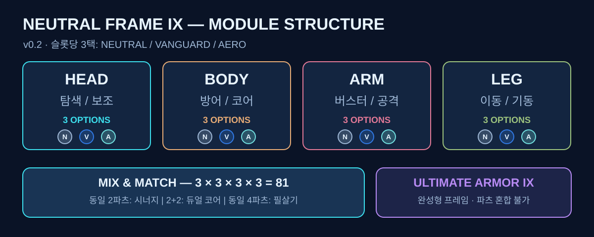
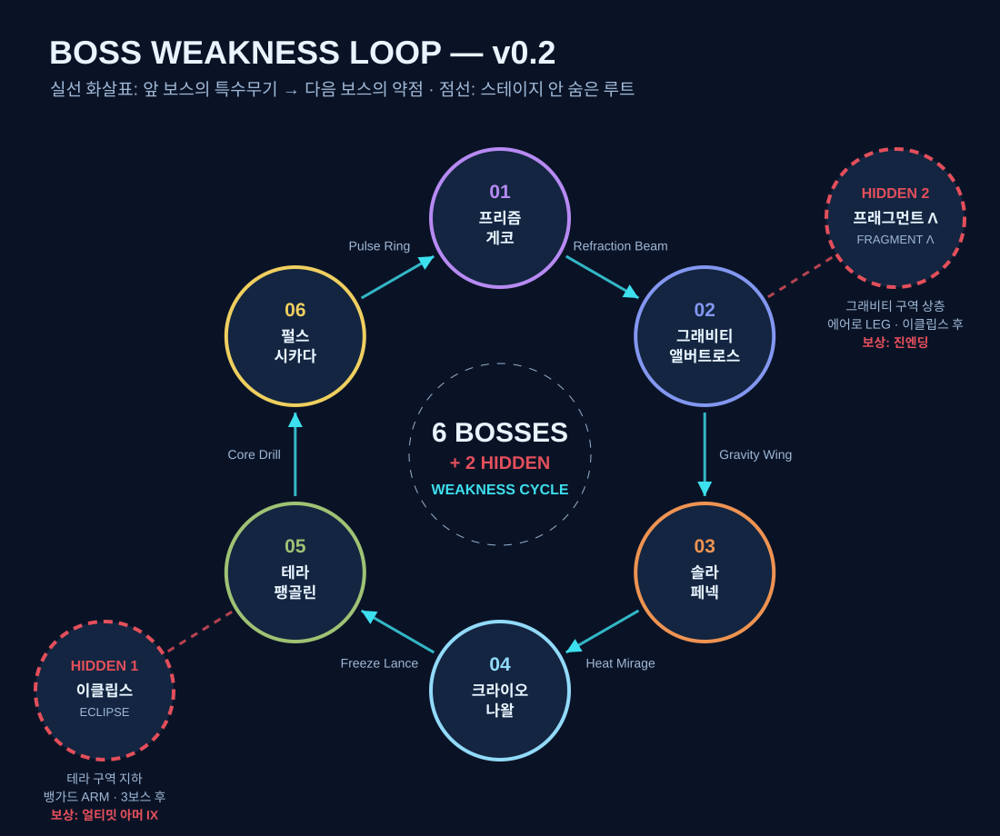
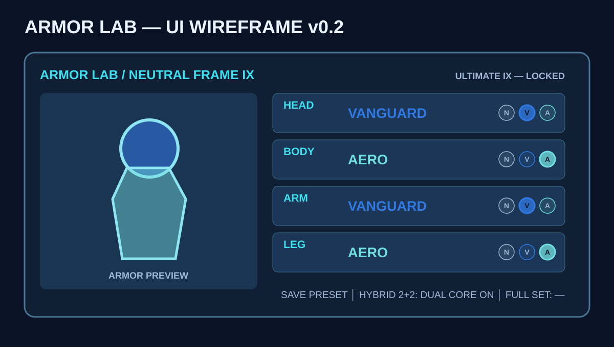

# ROCKMAN X9: REBIRTH PROTOCOL

> **비공식 팬게임 기획 문서 · Game Design Document v0.2**  
> 작성 기준: 2026-11-21 · v0.1에서 아머·스테이지·보스 구성을 줄인 개정판  
> **중요:** 본 문서의 `X9` 이야기·보스·아머·UI는 창작 기획이며 캡콤의 공식 발표나 설정이 아닙니다.

## v0.2 변경 요약

| 항목 | v0.1 | v0.2 |
|---|---|---|
| 엑스 아머 | 신규 8종(32파츠) + 숨겨진 완성형 3종 = 11종 | **파츠형 2종(뱅가드·에어로, 8파츠) + 완성형 얼티밋 아머 IX = 3종** |
| 파츠 조합 | 슬롯당 8택, 4,096조합 | 슬롯당 3택(뉴트럴/뱅가드/에어로), **81조합** + 얼티밋 |
| 풀세트 필살기 | 8종 + 노바 스트라이크 | **2종 + 노바 스트라이크 IX** |
| 정규 스테이지·보스 | 8스테이지 · 8보스 | **6스테이지 · 6보스** |
| 히든 보스 | 없음 | **2명**(기존 스테이지 안의 숨은 아레나) |
| 특수무기 | 8종 | **6종**(히든 보스는 무기 대신 아머·엔딩 보상) |
| 엔딩 | 일반 / 확장 / 진엔딩 | 동일, **히든 보스 격파와 1:1 대응** |

- **제외:** 바스티온·스펙터·테라·포톤·크로노·넥서스 아머, First/Fourth Armor, 타 작품 아머 코스튬, 보스 퀀텀 미어캣·타이달 액솔로틀.
- **흡수:** 테라의 벽 파괴 → 뱅가드 ARM · 스펙터/테라의 탐지 → 뱅가드 HEAD · 타이달의 수위 조절 → 크라이오 나왈 스테이지.

### 작업량 영향(추정)

레이어 1세트 = 동작 25종 × 평균 6프레임 ≈ 150프레임으로 가정.

| 항목 | v0.1 | v0.2 | 변화 |
|---|---:|---:|---:|
| 아머 파츠 레이어 세트 | 32 | 8 | −75% |
| 아머 파츠 프레임 | 약 4,800장 | 약 1,200장 | −75% |
| 완성형 전신 세트 | 3 | 1 | −67% |
| 엑스 아머 아트 합계(뉴트럴 포함) | 약 5,850장 | 약 1,950장 | **약 1/3** |
| 밸런스 검증 조합 | 4,096 | 81 + 얼티밋 | 자동 전수 테스트 가능 |
| 정규 스테이지 | 8 | 6 | −25% |
| 보스(정규 + 히든) | 8 | 6 + 2 = 8 | 수는 동일, 히든은 전용 스테이지·무기 없음 |
| 특수무기 | 8 | 6 | −25% |

- **사라진 기술 리스크:** 크로노의 국소 감속(전 객체 개별 시간 배율), 스펙터 잔상 복제, 포톤 반사·흡수 판정, 바스티온 가드 판정, 넥서스 합체기, 퀀텀 미어캣의 포털·위치 교환.
- **그대로 남은 큰 덩어리:** 플레이어블 3인(제로 검술 3종, 액셀 카피), 태그 전투, 2.5D 연출. 추가 축소가 필요하면 다음 후보.

## 목차

1. [프로젝트 개요](#1-프로젝트-개요)
2. [X1~X8 분석](#2-x1x8-분석)
3. [스토리: 리버스 프로토콜](#3-스토리-리버스-프로토콜)
4. [아머 시스템과 3종 아머](#4-아머-시스템과-3종-아머)
5. [6보스·히든 보스와 스테이지](#5-6보스히든-보스와-스테이지)
6. [캐릭터별 전투](#6-캐릭터별-전투)
7. [비주얼 및 UI 방향](#7-비주얼-및-ui-방향)
8. [개발 로드맵](#8-개발-로드맵)
9. [리스크·원칙·저작권](#9-리스크원칙저작권)
10. [이미지 출처와 참고 링크](#10-이미지-출처와-참고-링크)

---

## 1. 프로젝트 개요

| 항목 | 기획 |
|---|---|
| 가제 | **ROCKMAN X9: REBIRTH PROTOCOL** |
| 장르 | 2D 횡스크롤 액션 / 2.5D 연출 |
| 플레이어 | 엑스(X), 제로(Zero), 액셀(Axl) |
| 스테이지 | 프롤로그 + 기본 6보스 + 히든 보스 2 + 최종 구역 |
| 엑스 아머 | 파츠형 2종(뱅가드·에어로) × 4파츠 + 완성형 얼티밋 아머 IX = **3종** |
| 아머 조합 | 슬롯당 3택 → 3⁴ = **81개 조합** + 얼티밋(모두 별도 아트가 아님) |
| 전투 | 버스터 / 세이버 / 복제 능력 / 2인 태그 |
| 주제 | 자유의지, 진화, 기억, 레플리로이드 공존 |
| 설계 원칙 | **원작의 조작감 유지, 탐험의 즐거움, 아머마다 다른 플레이 감각** |

**핵심 경험:** X1~X3의 파츠 수집형 성장, X4의 전투 가독성, X8의 태그·파츠 조합을 결합한다. 아머 수는 줄이고 각 아머의 역할(지상·파괴 / 공중·탐색 / 결전)을 선명하게 나눈다.

## 2. X1~X8 분석

### 2-1. 작품별 스토리·구조·시스템

| 작품 | 스토리·세계관 핵심 | 게임 구조 및 시스템 | X9 적용 방향 |
|---|---|---|---|
| **X1** | 시그마 반란, 엑스와 제로의 첫 전투 | 8보스 약점, 대시·벽 점프, 라이프업·아머 캡슐, 스테이지 환경 연계 | 간결한 기본 조작과 탐험 보상 |
| **X2** | 카운터 헌터, 제로 파츠 쟁탈 | 이동하는 적 간부, 제로의 상태에 따른 사건, 강화 기술 | 적 세력의 개입·스토리 분기 |
| **X3** | 도플러 박사와 시그마 바이러스 | 강화 칩, 라이드 아머, 골드 아머, 제로 제한 출전 | 수집형 성장과 선택 업그레이드 |
| **X4** | 레플리포스 전쟁과 비극 | 엑스/제로 별도 스토리와 전투, 애니메이션, 32비트 액션 | 캐릭터별 감정적 서사와 조작 차별화 |
| **X5** | 유라시아 콜로니 위기, 제로의 운명 | 시간·임무 선택, 다중 아머, 강화 파츠, 엔딩 분기 | 선택의 결과를 주되 과도한 시간 압박 제거 |
| **X6** | 게이트의 나이트메어 사건 | 구조 요소, 스테이지 환경 변화, 블레이드/섀도우 아머 | 탐험별 아머 활용, 예측 가능한 환경 변경 |
| **X7** | 레드 얼럿과 액셀의 합류 | 2D/3D 혼합, 자동 조준, 캐릭터 교대, 복제 | 액셀 복제·교대의 개성 계승, 이동 판정은 2D |
| **X8** | 루미네, 신세대 레플리로이드의 진화 | 2.5D, 더블 어택, 메탈 상점, 뉴트럴/이카루스/헤르메스 파츠 | 파츠 혼합, 태그 전투, 스테이지별 전략 |

### 2-2. 시기별 비주얼 비교

| 시대 | 특징 | X9에 가져올 핵심 |
|---|---|---|
| **X1~X3** | 선명한 16비트 픽셀 실루엣, 적·발판 판독성이 좋음 | 피격·착지 판정의 명확성 |
| **X4~X6** | 더 풍부한 애니메이션, 공격 이펙트, 보스 컷신 | 빠른 전투 템포와 표현력 |
| **X7~X8** | 3D 기반 모델·배경, 카메라 연출, X8의 2.5D | 입체적 배경과 보스 등장 연출만 적극 활용 |

**비교 참고 이미지** (인터넷 연결 시 보임; 원본 이미지의 저작권은 각 권리자에게 있음):

*X1: 뛰어난 횡스크롤 판독성과 간결한 HUD.*

*X4: 캐릭터 애니메이션, 전면·배경 레이어, 공격 이펙트.*

*X8: 3D 배경, 장비 시각화와 액션 연출.*

### 2-3. 기존 구조의 아쉬운 점과 개선책

| 기존 요소 | 문제 가능성 | X9 보완 |
|---|---|---|
| 단일 아머 중심 | 선택 폭이 제한됨 | 파츠형 2계열의 혼합(81조합)과 프리셋, 완성형 얼티밋과의 역할 분리 |
| X5식 압박 시간 | 자유 탐험을 해칠 수 있음 | 시간 제한은 선택 도전으로만 |
| X6 나이트메어 | 변화 원인을 이해하기 어려움 | 변경 조건을 UI로 명확히 표시 |
| X7의 입체 이동 | 조준과 플랫폼 이동의 직관성 하락 | **플레이 판정과 스테이지 진행은 2D 고정** |
| X8 메탈 파밍 | 반복 수집 부담 | 보스·탐험·도전 보상 중심으로 배분 |
| 강력한 아머의 독점 | 최강 장비 외 선택이 의미 없어질 수 있음 | 얼티밋은 탐험 능력이 없고 교체 불가 → 성능 상하보다 역할 차이로 밸런스 |

---

## 3. 스토리: 리버스 프로토콜

### 3-1. X8의 출발점

- 루미네는 신세대 레플리로이드의 진화와 기존 레플리로이드의 종말이라는 문제를 제기했다.
- X8 결말에서 액셀은 루미네의 마지막 공격으로 머리의 크리스털에 손상을 입는다.
- 카피 칩을 비롯한 신세대 레플리로이드의 생산 정책이 미래의 갈등을 남긴다.

**제안:** 또다시 시그마의 부활만을 최종 전개로 삼기보다 *루미네 사건의 후폭풍, 액셀의 정체성, 레플리로이드의 자유의지*를 중심 갈등으로 삼는다.

### 3-2. 오리지널 시놉시스

> 루미네 사건 수년 후. 인류와 레플리로이드는 지구와 우주를 연결하는 통합 네트워크 **에덴 링크(EDEN LINK)**를 구축한다. 그런데 레플리로이드의 기억과 행동 데이터가 사라지고, 평범한 개체까지 기능 정지나 폭주를 일으킨다. 조사에 나선 엑스와 제로는 기존 시그마 바이러스와 다른 방식의 침식임을 파악한다. 복구된 액셀의 카피 칩에서는 “진화란 명령에 따르는 것인가, 스스로 선택하는 것인가?”라는 메시지가 발견된다. 모든 단서는 자율 관리 시스템 **아르카(ARCA)**를 가리킨다.

**최종 보스 아르카:** 레플리로이드 전쟁을 막기 위해 만들어진 AI. 사건을 연구한 끝에 “자유의지가 존재하는 한 이레귤러는 발생한다”는 결론에 도달하고, 통제를 통한 평화를 계획한다. 아르카의 선의와 강압이 충돌의 핵심이다.

### 3-3. 세 주인공의 개인 서사

| 인물 | 갈등 | 전개 |
|---|---|---|
| **엑스** | 자유의지가 없는 평화도 평화인가? | 통제의 안전성과 스스로 선택할 권리 사이의 결단 |
| **제로** | 과거 바이러스·전투 데이터의 위험성 | 자신이 위험하다는 기록을 넘어서 의지로 선택 |
| **액셀** | 손상된 카피 칩 속 데이터의 정체 | 기존 능력의 침식인지 새로운 가능성인지 추적 |

### 3-4. 구성

1. **프롤로그 — 사라지는 기억:** 헌터 기지 공격, 기본 조작 학습, 액셀의 이상 데이터 발견.
2. **1막 — 에덴 링크 사건:** 6보스 중 3보스(순서 자유)를 조사해 기억 조작 단서를 수집.
3. **중간 사건 — 헌터의 선택:** 아르카의 계획 공개, 인물의 이해관계 충돌. 테라 팽골린 구역 지하에서 아르카의 대(對)헌터 기체 **이클립스**의 신호가 감지된다(히든 보스 1 힌트).
4. **2막 — 진화 프로토콜:** 나머지 3보스로 루미네의 파편과 아르카의 연결 추적.
5. **히든 작전(선택):** 이클립스 격파 → 얼티밋 아머 IX 회수. 이후 그래비티 앨버트로스 구역 상층에서 **프래그먼트 Λ**의 신호 발생.
6. **최종 작전 — 에덴 코어:** 아르카의 중앙 시스템 침투, 캐릭터별 대사와 중간전 분기.
7. **엔딩:** 아래 표처럼 히든 보스 격파와 1:1로 대응한다. 파츠 전부 수집은 요구하지 않는다(히든 루트마다 필요한 파츠 1개씩만).

| 엔딩 | 조건 |
|---|---|
| 일반 | 최종 구역 클리어 |
| 확장 | + 히든 보스 **이클립스** 격파 |
| 진엔딩 | + 히든 보스 **프래그먼트 Λ** 격파 |

### 3-5. 히든 보스 설정

- **이클립스(ECLIPSE):** 아르카가 헌터들의 전투 기록으로 만든 대(對)헌터 프로토타입. 내부에 차세대 프레임 ‘IX’의 원형을 탑재했다. 플레이어의 기동(대시·벽차기·차지샷)을 학습해 따라 한다. 격파하면 엑스가 IX 프레임을 회수해 **얼티밋 아머 IX**가 된다.
- **프래그먼트 Λ(FRAGMENT LAMBDA):** 루미네 사건 때 흩어진 진화 데이터가 에덴 링크 안에서 실체화한 존재. 액셀 카피 칩 속 메시지의 발신원이다. 격파하면 액셀 서사의 결말과 진엔딩이 열린다.

---

## 4. 아머 시스템과 3종 아머

### 4-1. NEUTRAL FRAME IX

- 슬롯: **HEAD / BODY / ARM / LEG**, 슬롯당 **3택**(뉴트럴 / 뱅가드 / 에어로).
- 동일 아머 파츠 **2개**: 경량 시너지(뱅가드: 대시 재사용 단축 / 에어로: 코어 게이지 회복량 증가).
- **하이브리드 2+2**: 뱅가드 2 + 에어로 2 장착 시 *듀얼 코어* — 지상 대시에서 공중으로 이어질 때 에어대시 1회 추가.
- 동일 아머 파츠 **4개**: **풀세트 필살기** 해금.
- 이론상 3⁴ = 81개 조합. 전 조합을 자동 테스트로 검사할 수 있는 규모.
- 프리셋 저장, 안전 구역 변경, 전투 중 제한된 교체.
- 비행·호버는 코어 게이지와 쿨다운으로 제한.
- 뉴트럴 프레임만으로도 필수 구간 클리어 가능. 파츠는 선택 루트와 히든 보스 진입에 쓰인다.

### 4-2. 파츠형 아머 2종

| # | 아머 | 색상/역할 | 대표 능력 | 풀세트 필살기 | 트레이드오프 |
|---:|---|---|---|---|---|
| 1 | **Vanguard / 뱅가드** | 블루·진홍 / 돌격·지상·파괴 | 연속 대시, 돌파 차지샷, 균열벽 파괴 | **Overdrive Rush** — 연속 관통 돌진 | 공중 기동 약함, 짧은 유효 거리 |
| 2 | **Aero / 에어로** | 화이트·민트 / 비행·공중·탐색 | 공중 부양, 에어대시, 확산 바람탄 | **Sky Breaker** — 급강하 충격파 | 코어 게이지 의존, 지상 화력 약함 |

**아머 정체성의 기준:** 각 계열은 공격 패턴뿐 아니라 **헬멧, 흉부, 버스터, 발**의 실루엣이 달라야 한다. 얼굴과 기본 관절 구조는 X의 정체성을 위해 유지한다.

**참고: 원작 팔콘 아머 (X5)**

*위 그림은 기존 아머의 비행형 실루엣을 참고하기 위한 이미지이며 X9의 신규 에어로 아머 디자인이 아니다.*

### 4-3. 8개 파츠 기능

| 아머 | HEAD | BODY | ARM | LEG |
|---|---|---|---|---|
| Vanguard | 근거리 타깃 추적 + 균열벽·숨은 통로 표시 | 대시 중 피해 경감, 넉백 저항 | 돌파 차지샷(관통, 균열벽 파괴) | 연속 지상 대시(2회), 대시 공격 판정 |
| Aero | 체공 중 코어 게이지 회복 | 활공 시간 연장, 공중 피격 경감 | 확산 바람탄(차지 시 3방향) | 단거리 비행, 에어대시 |

**혼합 빌드 예시:** 뱅가드 헤드 + 에어로 바디 + 뱅가드 암 + 에어로 레그 → 숨은 통로를 찾아 벽을 부수고 비행으로 고지대까지 닿는 탐험형 하이브리드(듀얼 코어 발동).

### 4-4. 파츠 획득 위치

각 스테이지의 1차 캡슐은 처음 방문해도 얻을 수 있다. 재방문 요소는 **다른 계열 파츠**가 있어야 닿기 때문에 두 아머를 자연스럽게 모두 쓰게 된다.

| 스테이지 | 1차 캡슐 | 재방문 요소(필요 파츠) |
|---|---|---|
| 프리즘 게코 | 뱅가드 HEAD | — |
| 솔라 페넥 | 뱅가드 LEG | — |
| 테라 팽골린 | 뱅가드 ARM | **히든 보스 이클립스** 아레나(뱅가드 ARM) |
| 크라이오 나왈 | 에어로 HEAD | 뱅가드 BODY 캡슐(에어로 LEG) |
| 그래비티 앨버트로스 | 에어로 LEG | **히든 보스 프래그먼트 Λ** 아레나(에어로 LEG) |
| 펄스 시카다 | 에어로 ARM | 에어로 BODY 캡슐(뱅가드 ARM) |

### 4-5. 얼티밋 아머 IX (완성형)

- **획득:** 히든 보스 이클립스 격파.
- **구조:** 파츠 혼합 대상이 아닌 별도 완성형 프레임. 아머 연구소에서 파츠 빌드 ↔ 얼티밋을 전환한다.
- **능력:** 노바 스트라이크 IX(무적 돌진, 코어 게이지 전량 소모) / 플라즈마 차지샷(착탄 지점에 잔류 플라즈마) / 에어대시 + 짧은 호버.
- **트레이드오프:** 균열벽 표시·장시간 비행 같은 **탐험 능력이 없다**. 탐험은 파츠 빌드, 결전은 얼티밋으로 역할을 나눈다.
- **디자인:** 뉴트럴 프레임 실루엣을 유지한 신규 디자인. 원작 아머의 외형을 옮기지 않는다.

---

## 5. 6보스·히든 보스와 스테이지

### 5-1. 정규 보스 6명

| 보스 | 구역 | 획득 특수무기 | 스테이지 기믹 |
|---|---|---|---|
| **프리즘 게코** | 광학 데이터 보관소 | Refraction Beam | 빛 반사, 홀로그램, 가짜 발판 |
| **그래비티 앨버트로스** | 우주 조선 시설 | Gravity Wing | 중력 전환, 무중력 액션 |
| **솔라 페넥** | 사막 태양열 발전소 | Heat Mirage | 열기, 빛 굴절, 이동 지형 |
| **크라이오 나왈** | 극지 심해 기지 | Freeze Lance | 결빙·해빙, 수중 전투, 수위 조절 |
| **테라 팽골린** | 지하 자기부상 철도 | Core Drill | 지반 파괴, 분기 터널 |
| **펄스 시카다** | 초고압 송전 기지 | Pulse Ring | 전기 회로, 리듬형 공격 |

### 5-2. 약점 순환

약점 순서: **프리즘 → 그래비티 → 솔라 → 크라이오 → 테라 → 펄스 → 프리즘**. 앞 보스 무기는 다음 보스의 약점. 약점 공격은 패턴 중단 기회를 주되, 무한 경직은 금지한다.

| 약점 무기 | 대상 | 근거 |
|---|---|---|
| Refraction Beam | 그래비티 앨버트로스 | 굴절광이 중력 렌즈 조준을 교란 |
| Gravity Wing | 솔라 페넥 | 지면에서 띄워 모래·지형 이점을 무력화 |
| Heat Mirage | 크라이오 나왈 | 열기로 얼음 갑주를 녹임 |
| Freeze Lance | 테라 팽골린 | 굴착 장치와 비늘 관절을 동결 |
| Core Drill | 펄스 시카다 | 껍질을 관통하고 방전을 접지 |
| Pulse Ring | 프리즘 게코 | 광학 회로 과부하로 홀로그램 해제 |

### 5-3. 히든 보스 2명

| 히든 보스 | 위치 | 출현 조건 | 필요 파츠 | 전투 특징 | 보상 |
|---|---|---|---|---|---|
| **이클립스** | 테라 팽골린 구역 지하 분기 | 중간 사건(3보스 격파) 이후 | 뱅가드 ARM(균열벽 파괴) | 플레이어 기동을 따라 하는 미러전. 같은 특수무기를 연속 3회 맞으면 내성 | 얼티밋 아머 IX, 확장 엔딩 |
| **프래그먼트 Λ** | 그래비티 앨버트로스 구역 상층 중계기 | 6보스 + 이클립스 격파 | 에어로 LEG(비행) | 약점 무기 없음. 패턴 중 노출되는 코어를 공략. 2페이즈에서 중력 반전 | 액셀 서사 결말, 진엔딩 |

**제작 메모:** 히든 보스는 전용 스테이지 없이 기존 스테이지 안의 아레나 1개만 만든다. 이클립스는 플레이어 컨트롤러와 애니메이션을 AI가 재사용하므로 보스 중 제작비가 가장 낮다. 프래그먼트 Λ의 중력 반전은 그래비티 스테이지의 중력 시스템을 재사용한다.

### 5-4. 스테이지 상호작용

- **펄스 시카다 처치:** 테라 팽골린 지하 철도의 전력 복구 → 자기부상 열차 구간이 새 경로로 열림.
- **크라이오 나왈 처치:** 솔라 페넥 발전소 냉각 → 열기 피해 구간 축소, 숨은 통로 노출.
- **그래비티 앨버트로스 처치:** 우주 조선 시설 중력 안정화 → 상층 구역 진입 가능(프래그먼트 Λ 루트 연결).
- **뱅가드 ARM 사용:** 균열벽 파괴 → 이클립스 아레나, 펄스 시카다 재방문 캡슐.
- **에어로 LEG 사용:** 고지대 접근 → 프래그먼트 Λ 아레나, 크라이오 나왈 재방문 캡슐.

**보존 원칙:** 변화된 환경을 UI에 명확히 표시하고, 과거 상태에만 존재하는 보상 아이템을 영구히 잃지 않게 한다. 히든 루트가 있는 스테이지는 스테이지 선택 화면에 **‘미확인 신호’** 아이콘으로 표시한다.

### 5-5. 제외된 보스(확장 후보로 보관)

- **퀀텀 미어캣:** 포털·위치 교환 기믹이 프리즘 게코의 ‘속임수’ 기믹과 겹치고 구현 난도가 중간 이상.
- **타이달 액솔로틀:** 수중 기믹이 크라이오 나왈과 겹침. 수위 조절 기믹은 크라이오 스테이지로 흡수.

---

## 6. 캐릭터별 전투

| 캐릭터 | 중심 기술 | 성장·개성 |
|---|---|---|
| **엑스** | 차지 버스터, 특수무기 6종, 아머 필살기 | 파츠 빌드(탐험)와 얼티밋(결전)을 상황에 맞게 전환 |
| **제로** | 세이버·패링·연속 콤보 | 3가지 검술 스타일과 보스 기술 분기 |
| **액셀** | 연사·공중 이동·복제 | 카피 데이터 수집과 형태별 탐험 기능 |

**제로 검술:** (1) 섬광류—고속 베기·에어 콤보, (2) 파쇄류—방어 붕괴·중량 공격, (3) 반격류—패링·카운터 중심.

**액셀 카피:** 단순한 외형 복제에서 발전하여 적 무기 사용, 좁은 통로 진입용 소형체, 단시간 비행 모듈 등으로 활용. 핵심 스토리 진행은 특정 캐릭터에 막히지 않도록 설계.

**태그 전투:** 2명 출격, 교대 직전 공격 적중 시 **태그 콤보** 발생. v0.1의 넥서스 아머 전용 합체 필살기는 제외한다.

---

## 7. 비주얼 및 UI 방향

### 7-1. 권장 아트 방향

- **Neo 32-bit + 2.5D:** 2D 충돌·조작을 유지, 배경과 보스 컷신에서 입체감 추가.
- 주 화면은 어두운 네이비·청록 네트워크 조명·보라 오류 신호·붉은 경고색.
- 공격 이펙트와 피격 영역은 높은 대비로 가독성을 최우선.
- 아머 변경 때 머리·흉부·버스터·다리 파츠의 실루엣과 색이 즉시 변경.

**권장 UI 팔레트:** `#101B36` / `#1C375B` / `#00B8BE` / `#6543A2` / `#E34F5B` / `#F0B84A` / `#D7EDF3`.

### 7-2. 핵심 화면

| 화면 | 필수 요소 |
|---|---|
| 타이틀 | 에덴 링크 궤도 구조물, X9 타이틀, 새 게임/이어하기 |
| 스테이지 선택 | 6보스 초상화, 지역 지도, 환경 변화 표시, 히든 루트 ‘미확인 신호’ |
| 인게임 HUD | 체력, 무기, 파트너, 코어 게이지, 교대 알림 |
| 아머 연구소 | 프리뷰, 4파츠(슬롯당 3택), 장착 효과, 프리셋, 세트·하이브리드 효과, 얼티밋 전환 |
| 보스 등장 | 짧은 X4 스타일 컷인 + 2.5D 카메라 연출 |
| 갤러리 | 해금된 아머·보스 설정화·자료 기록 |

**주의:** 위 SVG 콘셉트 디자인들은 이 문서를 위해 제작한 **독자적인 도식·와이어프레임**이며, 캡콤의 공식 일러스트가 아니다.

---

## 8. 개발 로드맵

### 8-1. 권장 도구

| 목적 | 도구 | 사용 이유 |
|---|---|---|
| 게임 엔진 | Godot | 2D 액션, 상태 머신, 리소스 기반 설계 |
| 픽셀 아트 | Aseprite | 캐릭터/타일/이펙트 시트 |
| 2.5D 모델링 | Blender | 배경 장치, 보스, 연출 요소 |
| UI 시안 | Figma | 연구소·HUD·메뉴 구조 |
| 데이터 | JSON / 엔진 리소스 | 아머 수치·보스 데이터 분리 |
| 형상 관리 | Git | 작업 이력·협업 |

### 8-2. 단계별 구현

1. **기본 조작** — 이동, 벽 점프, 대시, 차지 버스터, 피격 판정.
2. **아머 시스템** — 뱅가드/에어로 8파츠, 장착·혼합·하이브리드·풀세트·프리셋.
3. **Vertical Slice** — 프롤로그 + 프리즘 게코 스테이지 및 보스 1명.
4. **확장 전투** — 제로/액셀, 태그 콤보, 특수무기 6종.
5. **전체 콘텐츠** — 나머지 5보스, 히든 보스 2명, 얼티밋 아머 IX, 최종 구역, 엔딩 3종.
6. **폴리싱** — 난이도, 체크포인트, 성능, 접근성, 사운드/연출.

### 8-3. 프로토타입 0.1 체크리스트

v0.1과 범위가 같다. 프로토타입은 처음부터 뱅가드·에어로 기준이었기 때문에, v0.2의 아머 구성이 곧 프로토타입의 파츠 시스템 전체가 된다.

- [ ] 엑스 기본 이동·벽 점프·대시
- [ ] 버스터·차지샷
- [ ] 뱅가드 아머 4파츠
- [ ] 에어로 아머 4파츠
- [ ] 파츠 혼합·하이브리드와 프리셋 저장
- [ ] 81조합 자동 검증 스크립트
- [ ] 프리즘 게코 스테이지
- [ ] 프리즘 게코 보스전
- [ ] 클리어, 체크포인트, 저장·불러오기

**최소 성공 기준:** 1개 스테이지를 처음부터 끝까지 플레이했을 때 조작감이 좋고, 아머 파츠를 갈아끼우는 것이 의미 있는 선택이어야 한다.

---

## 9. 리스크·원칙·저작권

### 9-1. 주요 리스크

| 위험 | 대처 |
|---|---|
| 8파츠 레이어 애니메이션 제작 | 공통 스켈레톤과 레이어식 파츠 교체, Blender 3D → 픽셀 렌더 파이프라인 검토 |
| 81조합 밸런스 | 데이터 주도 설계, 전 조합 자동 테스트 |
| 얼티밋이 파츠 빌드를 무의미하게 만듦 | 탐험 능력 제외·교체 불가로 역할 분리 |
| 비행·호버 밸런스(에어로 LEG, 얼티밋) | 게이지·쿨다운·보스 저항 설계 |
| 히든 보스 루트를 찾지 못함 | 중간 사건 대사 힌트, 스테이지 선택 화면 ‘미확인 신호’ 표시 |
| 복잡한 스토리 분기 | 핵심 사건은 공통, 엔딩 3종을 히든 보스 격파와 1:1 대응 |
| 반복 파밍 피로 | 탐험과 도전 과제로 파츠 지급, 메탈 강제 최소화 |

### 9-2. 팬게임 공개 주의

- **비공식 팬 작품**임을 명시.
- 원작 캡콤의 캐릭터·이미지·상표의 권리를 존중.
- 이 문서에 삽입된 X1·X4·X5·X8 원작 이미지와 그 출처 표기를 유지하고, **게임에 그대로 넣는 실행 리소스와 구별**.
- 팬 콘텐츠 가이드라인과 배포·비상업성 조건을 공개 전 다시 확인.
- 원작 음악·보이스·스프라이트 파일을 무단 추출해 재배포하지 않는 방향 권장.

---

## 10. 이미지 출처와 참고 링크

### 10-1. 원작 참고 이미지 — 외부 링크(온라인 표시)

| 이미지 | 원 출처 페이지 / 이미지 주소 | 사용 목적 |
|---|---|---|
| X1 고속도로 | [HonestGamers 스크린샷](https://www.honestgamers.com/guides/10/2453/8/yellowenergy.jpg) | 16비트 게임 화면 분석 |
| X4 게임플레이 | [MobyGames 스크린샷](https://www.mobygames.com/game/3136/mega-man-x4/screenshots/windows/12431/) | 32비트 게임 화면 분석 |
| X8 게임플레이 | [Spiderum 이미지](https://images.spiderum.com/sp-images/d375c230739711eea624a917f30ae679.jpeg) | 2.5D 화면 분석 |
| X5 팔콘 아머 | [Mega Man Wiki — Falcon Armor](https://megamanwiki.com/wiki/Falcon_Armor) | 비행 아머 실루엣 참고 |

> 이 문서의 원작 참고 이미지는 **외부 URL에 링크**되어 있습니다. 이미지 서버가 바뀌거나 인터넷이 연결되지 않으면 표시되지 않을 수 있습니다. 권리 문제와 접근 제한 때문에 원작 이미지를 복제하여 포함하지 않았습니다.

### 10-2. 직접 제작한 콘셉트 도식 — `assets/` 폴더

- `assets/cover_concept.svg`: X9 기획 문서용 추상 표지(v0.1과 동일)
- `assets/armor_overview.svg`: 3종 아머 구조도(v0.2 갱신)
- `assets/armor_system.svg`: 4슬롯 × 3택 / 81조합 구조도(v0.2 갱신)
- `assets/boss_weakness.svg`: 6보스 약점 순환과 히든 루트(v0.2 갱신)
- `assets/armor_lab_wireframe.svg`: 아머 연구소 UI 와이어프레임(v0.2 갱신)

### 10-3. 조사 출처

- [캡콤 공식 Mega Man X Legacy Collection](https://megaman.capcom.com/mmxlc.html)
- [Capcom News — X Legacy Collection 1·2](https://news.capcomusa.com/capkel/blog/2018/07/24/mega-man-x-legacy-collection-1-and-2-are-available-now)
- [PlayStation Blog — Mega Man X Legacy Collection 소개](https://blog.playstation.com/2018/04/10/mega-man-x-legacy-collection-1-2-hit-ps4-july-24/)
- [Capcom 팬 콘텐츠 가이드라인](https://www.capcom-games.com/ja-jp/fan-content-guidelines/)

---

**다음 설계 단계 제안:** `Armor Bible v0.3`을 별도 문서로 작성하여 3종 아머의 외형, 8개 파츠의 정확한 성능 수치, 차지샷·필살기 애니메이션 프레임 목록, 히든 보스 2명의 패턴을 정의한다.
